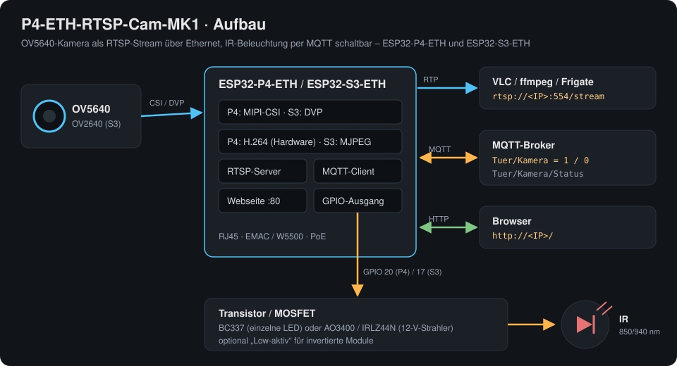

# P4-ETH-RTSP-Cam-MK1

**Version 1.2.1**

Firmware für das **Waveshare ESP32-P4-ETH**: Das Bild einer angeschlossenen **OV5640-Kamera (MIPI-CSI, 2 Lanes)** wird mit dem **Hardware-H.264-Encoder** des ESP32-P4 kodiert und als **RTSP-Stream über die Ethernet-Schnittstelle** (RJ45, optional PoE) ins Netzwerk gesendet.



## Funktionen

- 1280×720 @ ~14 fps (Standardformat des OV5640-Treibers über MIPI-CSI)
- H.264 Baseline per Hardware, Bitrate/GOP/QP einstellbar
- RTSP-Server mit RTP über **TCP (interleaved)** und **UDP (unicast)**, bis zu 4 Clients gleichzeitig
- Neue Clients bekommen sofort ein IDR-Frame (kein Warten auf das nächste GOP)
- DHCP oder statische IP, Hostname einstellbar
- **IR-Beleuchtung ein/aus über MQTT**, z. B. `Tuer/Kamera` = `1` / `0` (GPIO frei wählbar)
- **Konfigurations-Webseite** unter `http://<IP-Adresse>/` (Netzwerk, MQTT-Broker, Schalt-Topic, IR-GPIO, Ein/Aus-Schalter) – gespeichert im NVS, kein Neukompilieren nötig
- Statusausgabe alle 10 s (fps, Bitrate, Clients, freier PSRAM) auf der seriellen Konsole

Stream-URL:

```
rtsp://<IP-Adresse>:554/stream
```

## Hardware

| Funktion            | GPIO / Wert                                   |
|---------------------|-----------------------------------------------|
| Ethernet MDC / MDIO | 31 / 52                                       |
| PHY-Reset           | 51                                            |
| PHY                 | IP101, Adresse 1                              |
| RMII                | TXD0 34, TXD1 35, TX_EN 49, RXD0 29, RXD1 30, CRS_DV 28, REF_CLK 50 (Eingang) |
| Kamera SCCB SCL/SDA | 8 / 7                                         |

Alle Werte lassen sich in `idf.py menuconfig` → **P4-ETH-RTSP-Cam-MK1** ändern.

> **Hinweis zur Kamera:** Das Board ist für Raspberry-Pi-kompatible 22-Pin-Kameras (0,5 mm Raster) ausgelegt. Das OV5640-Modul muss MIPI-CSI-2 mit 2 Lanes und einen 22-Pin-Stecker haben (ggf. Adapterkabel 15→22 Pin).

## Fertige Firmware flashen (ohne ESP-IDF)

Im Release liegen zwei Gesamt-Images (Bootloader + Partitionstabelle + App), die **an Adresse `0x0`** geschrieben werden:

| Datei | Chip-Revision |
|---|---|
| `P4-ETH-RTSP-Cam-MK1-v1.2.1-chip-rev-v3.bin` | ESP32-P4 v3.x |
| `P4-ETH-RTSP-Cam-MK1-v1.2.1-chip-rev-v1.bin` | ESP32-P4 v0.x / v1.x |

**Im Browser (Chrome/Edge):** <https://espressif.github.io/esptool-js/> öffnen → *Connect* → Port des Boards wählen → Flash Address `0x0`, Datei wählen → *Program*. Die Chip-Revision steht nach *Connect* im Log.

**Per Kommandozeile:**
```bash
esptool.py --chip esp32p4 -b 460800 write_flash 0x0 P4-ETH-RTSP-Cam-MK1-v1.2.1-chip-rev-v3.bin
```

> Eine UF2-Datei gibt es für den ESP32-P4 nicht: Der Chip hat keinen UF2-Bootloader (kein „Laufwerk zum Draufkopieren“ wie beim RP2040).

## IR-Beleuchtung über MQTT schalten

1. IR-LED/IR-Strahler anschließen (siehe unten), Board starten, `http://<IP>/` öffnen.
2. MQTT-Broker eintragen (z. B. `mqtt://192.168.1.10:1883`), ggf. Benutzer/Passwort, **Schalt-Topic** (Standard `Tuer/Kamera`) und GPIO → *Speichern & Neustart*.
3. Schalten:

```bash
mosquitto_pub -h 192.168.1.10 -t Tuer/Kamera -m 1 -r     # ein
mosquitto_pub -h 192.168.1.10 -t Tuer/Kamera -m 0 -r     # aus
```

Akzeptiert werden `1`/`0`, `on`/`off`, `ein`/`aus`, `true`/`false` sowie `toggle`.
Mit `-r` (retained) übernimmt das Board den Zustand auch nach einem Neustart; ohne Broker startet die Beleuchtung **aus**.

| Topic | Richtung | Inhalt |
|---|---|---|
| `Tuer/Kamera` | → Board | `0` / `1` – Beleuchtung aus / ein |
| `Tuer/Kamera/Status` | ← Board | aktueller Zustand `0` / `1` (retained) |
| `Tuer/Kamera/Verfuegbar` | ← Board | `online` / `offline` (retained, Last Will) |
| `Tuer/Kamera/Info` | ← Board | Version, IP, RTSP-URL (retained) |

Wird über die Webseite geschaltet, schreibt das Board den neuen Wert retained auf das Schalt-Topic, damit Broker und Board übereinstimmen.

Ohne MQTT per HTTP:
```bash
curl -X POST http://<IP>/licht -d 1      # ein
curl -X POST http://<IP>/licht -d 0      # aus
```

### IR-Beleuchtung anschließen

Der GPIO liefert nur ein 3,3-V-Schaltsignal mit wenigen mA – die LED(s) immer über einen Transistor/MOSFET schalten:

**Einzelne IR-LED (bis ca. 100 mA):**
```
GPIO ──[ 1 kΩ ]── Basis  NPN (BC337 / 2N2222)
                  Emitter ── GND
5V ──[ Vorwiderstand ]──►|── Kollektor
```
Vorwiderstand ≈ (5 V − 1,4 V) / Strom, z. B. 47 Ω für ~75 mA.

**IR-Strahler / LED-Array (12 V):** Logic-Level-MOSFET (z. B. AO3400, IRLZ44N), Gate über 100 Ω an den GPIO, 100 kΩ Gate→GND, Strahler zwischen +12 V und Drain, Masse von Board und Netzteil verbinden. Fertige MOSFET-Module funktionieren ebenso.

Module mit Low-aktivem Eingang (z. B. viele Relais-Module): auf der Webseite „Ausgang Low-aktiv“ anhaken.

Der Standard-GPIO 20 ist nur ein Vorschlag – auf der Webseite lässt sich jeder freie Pin der Stiftleiste einstellen. Nicht verwenden: 7/8 (Kamera), 28–35, 49–52 (Ethernet), 24–27 (USB), 37/38 (UART0).

## Webseite

`http://<IP>/` zeigt Status (IP, RTSP-URL, Clients, MQTT-Verbindung), einen Ein/Aus-Schalter für die IR-Beleuchtung und die Einstellungen. Zusätzlich gibt es `GET /api/status` (JSON). Die Seite hat keinen Passwortschutz – nur im eigenen Netz betreiben.

## Selbst bauen

Voraussetzung: **ESP-IDF v5.5.4** (von Waveshare empfohlen, mindestens v5.4).

```bash
idf.py set-target esp32p4
idf.py build
idf.py -p /dev/ttyUSB0 flash monitor      # Windows: -p COM5
```

Die Komponenten `espressif/esp_video` (inkl. OV5640-Treiber) und `espressif/esp_h264` lädt der IDF Component Manager beim ersten Build automatisch.

### Chip-Revision beachten

ESP32-P4-Chips **v3.x** und **v0.x/v1.x** sind in ESP-IDF ≥ 5.5.2 nicht binärkompatibel. Revision prüfen:

```bash
esptool.py --chip esp32p4 chip_id
```

- **v3.x** → normal bauen (Standard)
- **v1.x** → so bauen:
  ```bash
  idf.py -DSDKCONFIG_DEFAULTS="sdkconfig.defaults;sdkconfig.defaults.rev_v1" build
  ```

Die Firmware erkennt beim Start selbst, ob die CSI-Einheit direkt YUV420 liefern kann (Revision v3: kein Kopieren) oder ob RGB565 per PPA (2D-DMA) umgewandelt werden muss (Revision v1).

## Stream abrufen

| Programm | Befehl / Einstellung |
|---|---|
| VLC | Medien → Netzwerkstream öffnen → `rtsp://<IP>:554/stream` |
| ffplay | `ffplay -rtsp_transport tcp rtsp://<IP>:554/stream` |
| ffmpeg (Aufnahme) | `ffmpeg -rtsp_transport tcp -i rtsp://<IP>:554/stream -c copy aufnahme.mp4` |
| Frigate / go2rtc / Home Assistant | Kamera-URL `rtsp://<IP>:554/stream`, Transport TCP empfohlen |

## Einstellungen (menuconfig)

| Menü | Option | Standard |
|---|---|---|
| Ethernet | PHY-Typ / Adresse / Reset-GPIO | IP101 / 1 / 51 |
| Ethernet | Statische IP | aus (DHCP) |
| Kamera | SCCB-Pins, Reset/PWDN | 8 / 7, keine |
| H.264 | Bitrate | 2,5 Mbit/s |
| H.264 | GOP | 28 (≈ 2 s) |
| H.264 | QP min/max | 20 / 38 |
| RTSP | Port / Pfad / max. Clients | 554 / `stream` / 4 |
| MQTT / IR-Beleuchtung | Startwerte für Broker, Schalt-Topic, GPIO, Low-aktiv | leer / `Tuer/Kamera` / 20 / nein |

## Fehlersuche

- **`esp_video_init fehlgeschlagen`** – Kabel/Stecker der Kamera prüfen (Kontakte richtig herum?), SCCB-Pins im menuconfig prüfen.
- **Kein Link** – Kabel/Switch prüfen; bei anderem PHY im menuconfig „Generischer IEEE-802.3-PHY“ und PHY-Adresse `-1` (Autosuche) wählen.
- **Ruckeln über UDP** – Client auf TCP umstellen (`-rtsp_transport tcp`, VLC: „RTP über RTSP (TCP)“).
- **Bootloop direkt nach dem Flashen** – falsche Chip-Revision gewählt (siehe oben).

## Projektstruktur

```
main/
  main.c          Start, Encoder-/Streaming-Task, Statistik
  eth_init.c      EMAC + IP101, DHCP / statische IP
  camera.c        OV5640 via esp_video (V4L2), YUV420-Ausgabe (direkt oder per PPA)
  rtsp_server.c   RTSP-Server, RTP-Paketierung (RFC 6184, FU-A)
  ir_light.c      Schaltausgang der IR-Beleuchtung
  mqtt_ctrl.c     MQTT-Client: <topic> = 0/1, Status/Verfuegbar/Info
  web_ui.c        Konfigurations-Webseite, /licht, /api/status
  app_config.c    Einstellungen im NVS
  Kconfig.projbuild
.github/workflows/build.yml   Firmware für beide Chip-Revisionen, Release bei Tag v*
```
